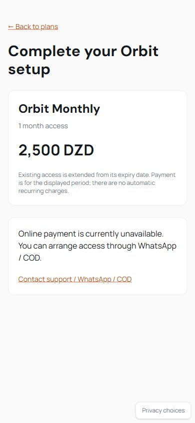

# Orbit commerce implementation delivery

Implemented in the existing React/Vite and Express/MongoDB application. Live payments
and server Meta delivery remain disabled. No production data, credentials, live
transactions or deployment were used during verification.

## Completed changes

- Direct registration using the existing password, cookie authentication and access services.
  Only name, email and password are initially required; registration grants no paid access.
- Landing and configured pricing CTAs lead into registration/login and checkout with safe,
  preserved plan selection. Existing activation links, QR onboarding and WhatsApp/COD remain.
- Central consent-gated Meta Pixel: asynchronous, one initialization, sanitized eligible
  navigation, browser conversion IDs supplied by the backend, and explicit withdrawal.
- Dedicated CAPI adapter with normalized hashes, encrypted outbox on internal AnalyticsEvent,
  asynchronous leased delivery, bounded retries, expiry and privacy-safe admin retry/status.
- SlickPay invoice adapter using documented merchant endpoints and hosted SATIM URLs.
  Backend price validation, frozen plan snapshot, one open order, unique invoice/payment
  references and strict verified completion protect access activation.
- A transaction confirms PAID, grants sourced access, records the internal purchase and queues
  eligible CAPI delivery together. Renewal reuses the existing calendar-duration rules and
  never shortens existing valid access.
- Responsive checkout, pending status/recovery, unsent-order cancellation, optional
  post-payment Telegram onboarding, and secured Admin → Payments.
- Existing first/last/non-direct attribution is retained through registration and payment
  return. Manual activation never becomes Purchase; no trial or automatic recurring billing
  is invented.

## Verification actually executed

| Check | Result |
|---|---|
| Full backend: `node ../node_modules/vitest/vitest.mjs run --maxWorkers 2` from server | **196 passed, 19 files** |
| Full frontend: same command from client | **28 passed, 10 files** |
| Targeted backend analytics + commerce run | **39 passed, 2 files** |
| `npm run lint` | **Passed** |
| `npm run build` | **Passed**, 2,964 modules transformed |
| `git diff --check` | **Passed** |
| Browser preview, desktop and 390×844 mobile | Landing, pricing, registration, selected-plan checkout, consent decline and unpaid access guard verified |

Commerce tests mock every provider HTTP request and use an isolated in-memory MongoDB
replica set. The full regression suites include QR batches/printing, multiuser activation,
plans/pricing, Telegram, analytics reporting, WhatsApp links, finance and existing product APIs.
The new tests cover disabled CAPI, normalization, browser/server IDs, refusal/withdrawal,
provider outage, invoice concurrency, verified/unknown payments, mismatches, replay,
ownership, quote expiry, snapshots, exactly-once activation, renewal and migration reruns.
Visitor and advertising-consent ownership are claimed inside the registration transaction;
a regression test confirms failed link registration cannot change anonymous ownership.
The mobile registration test used only disposable local data; online payment and Meta
were disabled. The temporary preview server/script was removed.

Initial verification exposed a pre-existing Mongoose snapshot declaration interpreting
feature objects as strings, plus new validation/test and payment-return issues. These
were fixed before the final successful suite runs. Snapshot features now use an explicit
subdocument schema; existing subscription dates are untouched. Final verification completed
on 2026-10-13 (Africa/Lagos).

The build lazy-loads Register, Checkout, Onboarding and AdminPayments; their gzip chunks
are approximately 1.17 KB, 2.95 KB, 0.87 KB and 1.00 KB respectively.

## Rollout and external work remaining

See [COMMERCE-DEPLOYMENT.md](COMMERCE-DEPLOYMENT.md) for **all environment variables,
HTTP endpoints, provider contract sources, merchant steps, consent/Meta Test Events
instructions, monitoring and rollback**.

1. Back up the database and use a MongoDB replica set. Deploy with flags off; run
   `npm run migrate:commerce -w server` on staging and then production. This was tested
   on disposable databases, **not run against your production database**.
2. Configure the public Pixel ID on Vercel and a **newly rotated** Meta token on Railway.
   Validate consent, sanitized URLs, Test Events and matching browser/server IDs before
   enabling live CAPI.
3. Configure SlickPay merchant credentials, HTTPS return URL and environment. Validate the
   exact documented/official-SDK response contract and DZD units with the merchant sandbox.
   Only then set production environment, `SLICKPAY_CONTRACT_VERIFIED=true` and
   `SLICKPAY_ENABLED=true`.
4. No webhook signature, automatic invoice-POST retry, terminal unpaid status mapping, or
   refund/reversal workflow was fabricated. Webhooks return 501; invoice GET reconciliation
   is authoritative. Unknown invoice-creation outcomes require merchant support review.
   These contract gaps and recovery limits are detailed in the deployment guide.

Database additions: PaymentOrder and AdvertisingConsent; optional User advertising
preference; AccessSubscription source/order and partial unique activation/order indexes;
encrypted internal-event Meta delivery state. Migration is repeatable and does not remove
users, links or grants or change expiry dates.

Customer flow: Landing → configured plan → register/login → billing → hosted SlickPay →
authenticated verification → durable paid access → optional onboarding → existing workspace.

## Files added

- `client/public/meta-pixel.html`
- `client/public/meta-pixel.js`
- `client/src/analytics/AdvertisingConsent.jsx`
- `client/src/analytics/AppAds.test.jsx`
- `client/src/analytics/meta.js`
- `client/src/analytics/meta.test.js`
- `client/src/pages/AdminPayments.jsx`
- `client/src/pages/Checkout.jsx`
- `client/src/pages/Checkout.test.jsx`
- `client/src/pages/Onboarding.jsx`
- `client/src/pages/Register.jsx`
- `client/src/pages/Register.test.jsx`
- `docs/COMMERCE-AUDIT.md`
- `docs/COMMERCE-DEPLOYMENT.md`
- `docs/commerce-mobile-checkout.png`
- `server/src/analytics/advertisingConsent.js`
- `server/src/analytics/metaProvider.js`
- `server/src/jobs/commerce.js`
- `server/src/models/AdvertisingConsent.js`
- `server/src/models/PaymentOrder.js`
- `server/src/routes/payments.js`
- `server/src/scripts/migrateCommerce.js`
- `server/src/services/paymentService.js`
- `server/src/services/registrationService.js`
- `server/src/services/slickpayProvider.js`
- `server/test/commerce.test.js`
- `shared/metaEvents.js`
- `docs/COMMERCE-DELIVERY.md`

## Files modified

- `.env.example`
- `ANALYTICS.md`
- `README.md`
- `client/.env.example`
- `client/src/App.jsx`
- `client/src/admin/layout/navigation.js`
- `client/src/analytics/AnalyticsConsent.jsx`
- `client/src/analytics/client.js`
- `client/src/api/client.js`
- `client/src/context/AuthContext.jsx`
- `client/src/marketing/GetStartedModal.jsx`
- `client/src/marketing/Landing.jsx`
- `client/src/pages/Access.jsx`
- `client/src/pages/Login.jsx`
- `client/src/pages/Pricing.jsx`
- `client/src/pages/admin/analytics/state.js`
- `client/src/utils/navigation.js`
- `server/package.json`
- `server/src/analytics/analyticsService.js`
- `server/src/analytics/consentService.js`
- `server/src/analytics/events.js`
- `server/src/analytics/sessionService.js`
- `server/src/app.js`
- `server/src/config/env.js`
- `server/src/middleware/security.js`
- `server/src/models/AccessSubscription.js`
- `server/src/models/AnalyticsEvent.js`
- `server/src/models/User.js`
- `server/src/routes/activation.js`
- `server/src/routes/analytics.js`
- `server/src/routes/auth.js`
- `server/src/routes/publicConfig.js`
- `server/src/server.js`
- `server/src/services/activationService.js`
- `server/test/analytics.test.js`
- `server/test/publicConfig.test.js`
- `shared/analyticsEvents.js`

## Mobile verification

